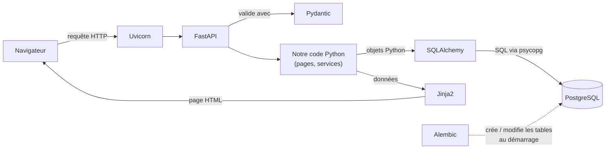
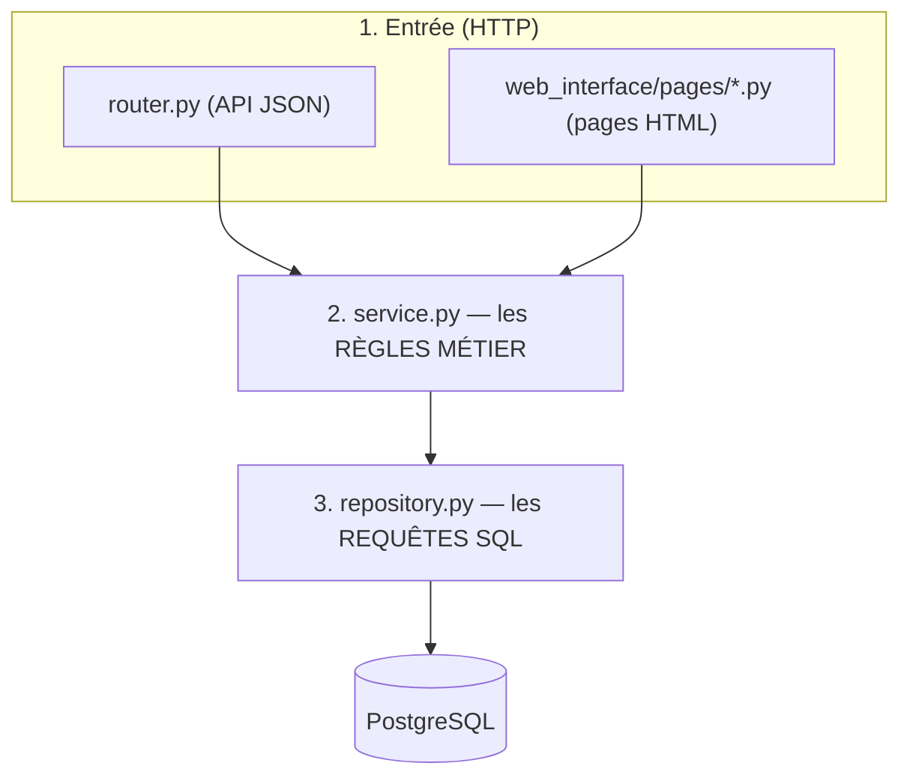
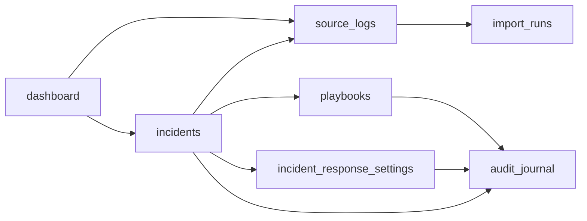
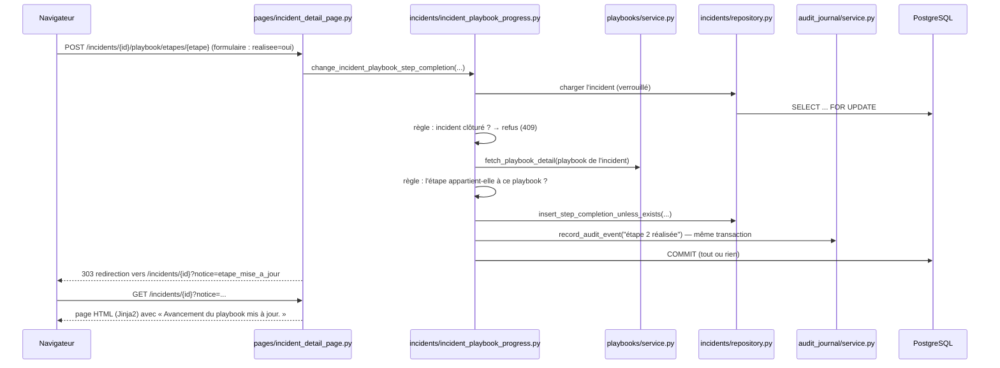

# Guide de lecture du code — Partie 1 : survol du projet

Objectif de cette partie : avant d'ouvrir le moindre fichier, savoir **ce que fait l'application**, **avec quels
outils**, **comment une requête la traverse** et **à quoi sert chaque dossier et chaque fichier**.
Les parties suivantes (voir [README.md](./README.md)) entreront dans le détail, couche par couche.

---

## 1. L'application en une phrase

Un analyste SOC ouvre son navigateur, voit les **alertes** venues de FortiAnalyzer, en fait des **incidents**, suit
pour chacun un **playbook** (une procédure en étapes), respecte des **délais** selon la sévérité, et tout ce qu'il
fait est inscrit dans un **journal d'audit**.

Le tout est **un seul programme Python** (le « backend ») relié à **une base PostgreSQL**. Ce programme fait deux
choses à la fois :

| Il sert… | À l'adresse | Pour qui |
|---|---|---|
| les **pages HTML** de l'interface | `http://localhost:8000/` | l'analyste, dans son navigateur |
| une **API JSON** | `http://localhost:8000/api/...` | un autre programme (futur collecteur, script, autre interface) |

Les deux utilisent **exactement les mêmes règles métier** : une règle n'est écrite qu'une seule fois.

---

## 2. Les outils, et le rôle de chacun

Lis ce tableau de haut en bas : c'est aussi l'ordre dans lequel une requête les traverse.

| Outil | Rôle en une phrase | Où on le voit dans le code |
|---|---|---|
| **Navigateur** | Affiche les pages HTML et envoie les formulaires. Aucun JavaScript n'est exécuté. | — |
| **Uvicorn** | Le serveur web : il écoute le port 8000 et passe chaque requête à FastAPI. | `Dockerfile`, `docker-compose.yml` (commande de démarrage) |
| **FastAPI** | Le cadre web : il associe une adresse (`/incidents`) à une fonction Python, lit les paramètres, appelle la fonction. | `backend/main.py`, tous les `router.py` et `web_interface/pages/*.py` |
| **Pydantic** | Le contrôleur des données : il vérifie que ce qui entre (formulaire, JSON) est correct, et met en forme ce qui sort. | tous les `schemas.py` |
| **Jinja2** | Le fabricant de pages : il prend un gabarit HTML « à trous » et le remplit avec les données. | `web_interface/templates/`, `web_interface/template_rendering.py` |
| **SQLAlchemy** | Le traducteur Python ↔ SQL : on manipule des objets Python, il écrit les requêtes SQL. | tous les `models.py` et `repository.py`, `backend/core/database.py` |
| **psycopg** | Le pilote : le « câble » entre SQLAlchemy et PostgreSQL. | invisible dans le code (dans `DATABASE_URL`) |
| **PostgreSQL** | La base de données : stocke incidents, alertes, playbooks, paramètres, journal. | `docker-compose.yml` (service `database`) |
| **Alembic** | Le gestionnaire de versions du schéma de la base : chaque changement de tables est un fichier numéroté. | `db/migrations/versions/0001…0003` |
| **pydantic-settings** | Lit la configuration dans les variables d'environnement / le fichier `.env`. | `backend/core/settings.py` |
| **Docker / Docker Compose** | Lance la base et le backend dans des conteneurs identiques sur tous les postes. | `Dockerfile`, `docker-compose.yml` |
| **pytest** | Lance les tests automatiques (sur une base SQLite jetable, sans Docker). | `tests/` |
| **SQLite** | Base de données « fichier » utilisée **uniquement par les tests** rapides. | `tests/conftest.py` |
| **tzdata** | Les fuseaux horaires, pour afficher les dates à l'heure de Paris. | `web_interface/display_formatting.py` |
| **python-multipart** | Permet à FastAPI de lire les formulaires HTML envoyés par le navigateur. | utilisé automatiquement par `Form(...)` |

> **Ce qui n'est plus utilisé** : OpenSearch Dashboards (prévu au départ comme interface) et le prototype React de
> l'équipe (`dashboard/` sur `main`). On a gardé le **visuel** de ce prototype, mais il est maintenant produit en
> Python. Le dossier `frontend/` est un ancien squelette sans rapport : il n'est pas utilisé.
>
> **Ce qui n'existe pas encore** : OpenSearch et la connexion des utilisateurs. La collecte FortiAnalyzer existe
> (mode démonstration ou réel, `APP_IS_IN_DEMO`) mais n'a pas encore été validée sur le vrai FortiAnalyzer.

### Comment les outils s'emboîtent

---

## 3. Comment ça fonctionne, de façon générale

### 3.1 Au démarrage (`docker compose up`)

1. Docker démarre **PostgreSQL** et attend qu'il soit prêt.
2. Docker démarre le **backend** avec la commande : `alembic upgrade head` puis `uvicorn backend.main:application`.
   - `alembic upgrade head` applique les migrations qui manquent (crée/modifie les tables). C'est sans danger à
     chaque démarrage : une migration déjà appliquée n'est pas rejouée.
3. Uvicorn charge `backend/main.py`, qui fabrique l'application :
   - branche toutes les routes de l'**API** sous `/api` ;
   - branche toutes les **pages** de l'interface (`web_interface/web_interface_registration.py`) ;
   - si `AUTOMATIC_ESCALATION_INTERVAL_SECONDS` > 0, lance la **boucle d'escalade automatique** en tâche de fond.

### 3.2 Les trois couches : la règle d'or du projet

Tout le code métier est rangé en **trois couches**. Une couche n'appelle que celle juste en dessous.

| Couche | Fait | Ne fait JAMAIS |
|---|---|---|
| `router.py` / `pages/*.py` | lire la requête, appeler le service, renvoyer la réponse (JSON ou HTML) | une règle métier, du SQL |
| `service.py` | appliquer les règles (« un incident clôturé est en lecture seule »…), décider du `commit` | du SQL, du HTTP |
| `repository.py` | lire/écrire en base | décider d'une règle métier |

Pourquoi : on peut changer l'interface sans toucher aux règles, et tester les règles sans passer par HTTP.

### 3.3 Une fonctionnalité = un dossier indépendant

Chaque sujet métier vit dans `backend/features/<nom>/` avec toujours la même structure :

| Fichier | Contient |
|---|---|
| `models.py` | les **tables** (classes SQLAlchemy) et les valeurs autorisées (statuts…) |
| `schemas.py` | les **formats d'entrée/sortie** (classes Pydantic) |
| `repository.py` | l'accès à la base |
| `service.py` | les règles métier + les **fonctions publiques** utilisables par les autres fonctionnalités |
| `router.py` | les routes de l'API JSON |
| `README.md` | le rôle du dossier, en quelques lignes |

**Règle** : une fonctionnalité n'importe **jamais** le `repository.py` ou le `models.py` d'une autre. Elle passe par
le `service.py` de l'autre. Exemple : `incidents` a besoin du délai d'une sévérité → il appelle
`incident_response_settings.service.fetch_response_deadline_rules_by_criticality(...)`, il ne lit pas la table
lui-même.

### 3.4 Les dépendances entre fonctionnalités

Lecture : « A → B » veut dire « A appelle le service public de B ». `audit_journal` et `import_runs` ne dépendent de
personne : ce sont de bons points de départ pour lire le code.

### 3.5 Le trajet d'un clic, de bout en bout

Exemple réel : sur la fiche d'un incident, l'analyste clique **« Fait »** sur l'étape 2 du playbook.

Ce schéma résume trois choix que tu retrouveras partout :
1. **POST → redirection → GET** : après une action, le serveur renvoie vers la page normale. Recharger la page
   (F5) ne rejoue donc jamais l'action.
2. **Le journal d'audit est écrit dans la même transaction** que l'action : soit les deux sont enregistrés, soit
   aucun. Le journal ne peut pas mentir.
3. **En cas de refus** (règle non respectée), pas de redirection : la page est réaffichée avec le message d'erreur.

---

## 4. Le rôle de chaque dossier et de chaque fichier

### 4.1 Racine du projet

| Fichier | Rôle |
|---|---|
| `AGENTS.md` | Les règles d'écriture du code (nommage, couches, docs, tests). **À lire en premier.** |
| `explain_project.md` | Le cadrage fonctionnel d'origine (pourquoi l'application existe). |
| `README.md` | Démarrage rapide et liens vers la doc. |
| `requirements.txt` | Les bibliothèques Python et leurs versions exactes. |
| `Dockerfile` | Comment construire l'image du backend. |
| `docker-compose.yml` | Les deux services (base + backend) et leur configuration. |
| `.env.example` | Modèle de configuration (copier en `.env`, jamais commité). |
| `alembic.ini` | Configuration d'Alembic (où sont les migrations). |
| `pytest.ini` | Configuration des tests. |

### 4.2 `backend/core/` — les briques communes (ne dépendent d'aucune fonctionnalité)

| Fichier | Rôle |
|---|---|
| `settings.py` | Lit la configuration (`DATABASE_URL`, `LOG_LEVEL`, intervalle d'escalade…). |
| `database.py` | Crée la connexion à la base ; fournit une **session** par requête (`get_database_session`). |
| `criticality.py` | Les 5 niveaux de sévérité (`critique`, `haute`, `moyenne`, `faible`, `information`). |
| `domain_errors.py` | Les erreurs métier : introuvable (404), conflit (409), règle violée (422). |
| `http_error_handlers.py` | Transforme ces erreurs en réponses JSON pour l'API. |
| `pagination.py` | Le découpage des listes en pages (`limit`, `offset`). |
| `utc_datetime_types.py` | Garantit que toutes les dates sont en UTC (entrée et sortie). |

### 4.3 `backend/` — l'assemblage

| Fichier | Rôle |
|---|---|
| `main.py` | **Point d'entrée.** Fabrique l'application : API sous `/api`, pages, boucle d'escalade. |
| `database_model_registry.py` | Importe toutes les tables pour qu'Alembic et les tests voient le schéma complet. |

### 4.4 `backend/features/` — les 8 fonctionnalités

| Dossier | Ce qu'il gère | Tables |
|---|---|---|
| `import_runs/` | L'historique des imports depuis FortiAnalyzer (réussi, échoué, combien). | `executions_import` |
| `source_logs/` | Les **alertes** (logs critiques), enregistrées une seule fois. | `logs` |
| `incidents/` | Le **cycle de vie d'un incident** (voir détail ci-dessous). | `incidents`, `etapes_realisees_incident` |
| `playbooks/` | Les procédures : nom, source, étapes. | `playbooks`, `etapes_playbook` |
| `incident_response_settings/` | Les **délais par sévérité** et l'escalade. | `delais_reponse_incidents` |
| `audit_journal/` | Le **journal d'audit**. | `journal_audit` |
| `dashboard/` | Les chiffres du tableau de bord (aucune table : il assemble les autres). | — |
| `log_collection/` | La **collecte** des alertes (FortiAnalyzer ou démonstration) : conversion, seuil, enregistrement. | — |

`backend/integrations/fortianalyzer/` : les **sources d'alertes** interchangeables (réception syslog réelle,
démonstration) et le choix selon `APP_IS_IN_DEMO`. Voir [log_collection.md](../technical/log_collection.md).

`incidents/` est la plus grosse ; son `service.py` a été découpé en plusieurs fichiers, chacun avec un seul rôle :

| Fichier | Rôle |
|---|---|
| `service.py` | Créer un incident, changer statut / sévérité / titre / catégorie / responsable / faux positif / playbook. |
| `incident_views.py` | Calculer ce qui n'est pas stocké : date limite, délai dépassé, plan (« 2/4 »), alertes. |
| `incident_playbook_progress.py` | Le playbook d'un incident et les étapes cochées. |
| `automatic_escalation.py` | L'escalade des incidents en retard + la boucle de fond. |
| `incident_statistics.py` | Les chiffres d'incidents pour le tableau de bord. |
| `incident_audit_trail.py` | Écrire un événement « incident » dans le journal. |

### 4.5 `web_interface/` — l'interface (pages HTML en Python)

| Élément | Rôle |
|---|---|
| `web_interface_registration.py` | Branche les pages et le CSS sur l'application ; affiche les erreurs en HTML (et en JSON pour `/api`). |
| `pages/*.py` | **Une page = un fichier.** Chacun : lit la requête, appelle les services, choisit le gabarit. |
| `templates/layouts/application_layout.html` | Le cadre commun à toutes les pages (menu latéral, barre du haut, titre, messages). |
| `templates/partials/` | Morceaux réutilisés : menu, barre du haut, onglets des Paramètres, petits éléments (pastilles, pagination). |
| `templates/pages/*.html` | **Un gabarit par page.** |
| `static/css/` | Le style, découpé : `foundation` (couleurs, base), `application_shell` (cadre), `components` (boutons, tableaux…), puis un fichier par page. |
| `application_layout.py` | Le contenu du menu et les compteurs (incidents ouverts, alertes à traiter). |
| `template_rendering.py` | Configure Jinja2 et lui ajoute des « filtres » d'affichage. |
| `display_formatting.py` | Traduit les valeurs de la base en texte lisible (`en_cours` → « En cours », dates à l'heure de Paris…). |
| `icons.py` / `icon_shapes.py` | Les icônes en SVG (`icon_shapes.py` est généré à partir de la maquette : ne pas l'éditer à la main). |
| `activity_chart_svg.py` | Dessine le graphique du tableau de bord. |
| `form_values.py` | Petites aides pour lire les formulaires et formuler les messages d'erreur. |
| `page_notices.py` | La liste des messages de confirmation autorisés (« Incident créé. »…). |

Correspondance pages ↔ fichiers :

| Adresse | Fichier Python | Gabarit |
|---|---|---|
| `/` | `dashboard_page.py` | `dashboard.html` |
| `/incidents` | `incidents_page.py` | `incidents.html` |
| `/incidents/{id}` | `incident_detail_page.py` | `incident_detail.html` |
| `/alertes` | `alerts_page.py` | `alerts.html` |
| `/journaux` | `journals_page.py` | `journals.html` |
| `/parametres/reponse-incidents` | `settings_incident_response_page.py` | `settings_incident_response.html` |
| `/parametres/playbooks…` | `playbooks_pages.py` | `playbooks.html`, `playbook_form.html` |
| `/parametres/journal-audit` | `settings_audit_journal_page.py` | `settings_audit_journal.html` |
| `/parametres/clients`, `/utilisateurs` | `settings_placeholder_pages.py` | `settings_placeholder.html` |

### 4.6 `db/migrations/` — l'histoire du schéma

| Fichier | Rôle |
|---|---|
| `env.py` | Dit à Alembic où est la base et quelles tables existent. |
| `versions/0001_create_initial_tables.py` | Crée `executions_import`, `logs`, `incidents`. |
| `versions/0002_add_consistency_constraints.py` | Ajoute des garde-fous (contraintes) en base. |
| `versions/0003_add_settings_playbooks_audit_journal.py` | Ajoute playbooks, délais, journal, et les nouvelles colonnes des incidents (référence, titre…). |

### 4.7 `tests/` — même organisation que le code

| Élément | Rôle |
|---|---|
| `conftest.py` | Prépare une base SQLite neuve **par test** (en jouant les vraies migrations) et deux clients : `api_client` (API) et `web_client` (pages). |
| `synthetic_data.py` | Fabrique des données de test **inventées** (préfixe `SYNTHETIQUE-`). |
| `features/<nom>/` | Tests de chaque fonctionnalité. |
| `web_interface/` | Tests des pages et des formulaires. |
| `test_database_schema.py` | Vérifie que les migrations correspondent au code et que les contraintes refusent les données incohérentes. |
| `postgresql_integration/` | Tests sur un vrai PostgreSQL (verrous, concurrence) ; ignorés si non configurés. |

### 4.8 `scripts/` et `docs/`

| Élément | Rôle |
|---|---|
| `scripts/load_synthetic_demo_data.py` | Remplit une base de développement avec des données de démonstration inventées. |
| `docs/overview/` | Explications simples (pour humains). |
| `docs/technical/` | Détails techniques, une page par fonctionnalité. |
| `docs/guide_lecture_code/` | Ce guide. |

---

## 5. Cinq conventions à connaître avant de lire

1. **Noms longs et explicites, en anglais pour le code, en français pour la base.** `fetch_incident_detail` est une
   fonction ; `criticite_actuelle` est une colonne (vocabulaire métier du cadrage).
2. **Une fonction privée commence par `_`** : elle n'est utilisée que dans son fichier.
3. **Les erreurs métier sont des exceptions** (`ResourceNotFoundError`…) levées par les services ; c'est l'entrée
   (API ou page) qui décide comment les montrer.
4. **Chaque action = une transaction** : le service fait lui-même son `commit` à la fin.
5. **Toutes les dates sont en UTC en base** ; elles ne sont converties à l'heure de Paris qu'à l'affichage.

## 6. Petit lexique (base de données → sens)

| Terme | Sens |
|---|---|
| `log` / alerte | Un événement critique venu de FortiAnalyzer. |
| `criticite_source` | La sévérité donnée par FortiAnalyzer. **Jamais modifiée.** |
| `criticite_actuelle` | La sévérité réévaluée par l'équipe (celle qui fixe le délai). |
| `statut` | `nouveau`, `en_cours`, `en_attente` (= ouvert) ; `resolu`, `cloture` (= traité). |
| `traite_le` | Quand l'incident est devenu résolu ou clôturé. |
| `escalade_le` | Quand l'incident a été escaladé automatiquement. |
| `numero_reference` | Le numéro affiché `INC-000042`. |
| `execution_import` | Un passage du collecteur. |

## 7. Ordre de lecture conseillé

1. `AGENTS.md` (5 min).
2. `backend/main.py` : comment tout est assemblé.
3. `backend/core/` : les briques communes (courtes).
4. Une petite fonctionnalité complète, dans l'ordre `models → schemas → repository → service → router` :
   **`audit_journal/`** (la plus simple).
5. `playbooks/`, puis `incident_response_settings/`.
6. `incidents/` (la plus riche).
7. `web_interface/` : `web_interface_registration.py`, puis une page simple (`journals_page.py` + `journals.html`),
   puis la fiche incident.
8. `tests/conftest.py`, puis les tests de la fonctionnalité que tu viens de lire.
