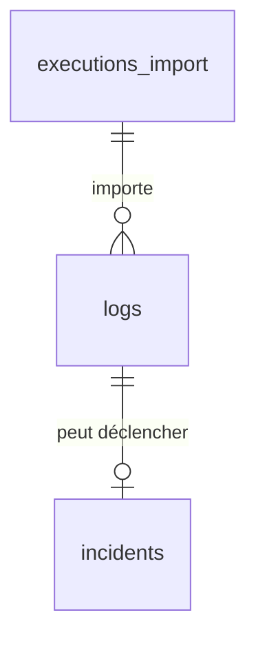

# Base de données PostgreSQL (V1)

Schéma géré par Alembic : [0001_create_initial_tables.py](../../db/migrations/versions/0001_create_initial_tables.py), [0002_add_consistency_constraints.py](../../db/migrations/versions/0002_add_consistency_constraints.py). Modèles : `backend/features/*/models.py`.
Conventions : clés UUID, dates `TIMESTAMPTZ` (UTC), noms de contraintes préfixés (`pk_`, `fk_`, `uq_`, `ck_`, `ix_`).

## `executions_import` (feature `import_runs`)

Une ligne par tentative de collecte.

| Colonne | Type | Règle |
|---|---|---|
| `id` | UUID PK | |
| `debut` / `fin` | timestamptz | `fin` est NULL **si et seulement si** `statut = 'en_cours'` ; `fin ≥ debut` ; `debut` indexé |
| `statut` | text | `en_cours`, `reussie`, `partielle`, `echouee` |
| `nb_logs_recus`, `nb_logs_inseres`, `nb_logs_ignores` | int | ≥ 0 ; `ignores` = doublons déjà connus ; `inseres + ignores ≤ recus` |
| `erreur` | text | détail sans secrets ; obligatoire (non vide) si `partielle`/`echouee`, NULL si `reussie` |
| `curseur_synchronisation` | text | point de reprise (nature dépendante de l'API FortiAnalyzer) |
| `created_at` | timestamptz | |

## `logs` (feature `source_logs`)

| Colonne | Type | Règle |
|---|---|---|
| `id` | UUID PK | |
| `identifiant_source` | varchar(255) | **UNIQUE**, obligatoire, non vide : clé de déduplication |
| `date_evenement` | timestamptz | indexée |
| `type` | varchar(255) | |
| `criticite_source` | varchar(32) | valeur FortiAnalyzer, jamais modifiée ; indexée ; CHECK sur les niveaux |
| `donnees_brutes` | JSONB | optionnel (stratégie de stockage à décider) |
| `reference_opensearch` | varchar(255) | optionnel |
| `arrivee_db` | timestamptz | |
| `execution_import_id` | UUID FK → `executions_import` | première exécution ayant enregistré le log ; `RESTRICT` |

Un log retrouvé lors d'un import ultérieur n'est pas recréé : il incrémente `nb_logs_ignores`.

## `incidents` (feature `incidents`)

| Colonne | Type | Règle |
|---|---|---|
| `id` | UUID PK | |
| `log_id` | UUID FK → `logs` | **UNIQUE** : un incident maximum par log en V1 |
| `statut` | varchar(32) | `nouveau`, `en_cours`, `en_attente`, `resolu`, `cloture` (provisoire) ; indexé |
| `criticite_actuelle` | varchar(32) | réévaluée par l'équipe ; initialisée avec `criticite_source` ; indexée |
| `faux_positif` | bool | si vrai, `justification` non vide obligatoire (CHECK) |
| `justification` | text | |
| `assigne_a` | varchar(255) | texte libre provisoire ; NULL = non assigné, jamais vide ; indexé |
| `created_at`, `updated_at` | timestamptz | `updated_at` mis à jour par l'ORM |
| `closed_at` | timestamptz | renseigné **si et seulement si** `statut = 'cloture'` ; `closed_at ≥ created_at` ; remis à NULL à la réouverture |

Niveaux de criticité : `information`, `faible`, `moyenne`, `haute`, `critique` (provisoires).

## Pourquoi `batch_alter_table` dans les migrations

SQLite (tests) ne sait pas ajouter une contrainte à une table existante : Alembic recrée la table. Sur PostgreSQL, ce
sont de simples `ALTER TABLE`. `db/migrations/env.py` active `render_as_batch` pour les migrations autogénérées.

## Modifier le schéma

1. Modifier le modèle. 2. `alembic revision --autogenerate -m "description"`. 3. Relire la migration (types PostgreSQL, défauts). 4. Ajouter/adapter les tests dans `tests/test_database_schema.py` (et `tests/postgresql_integration/` si pertinent). 5. Mettre à jour ce document.
