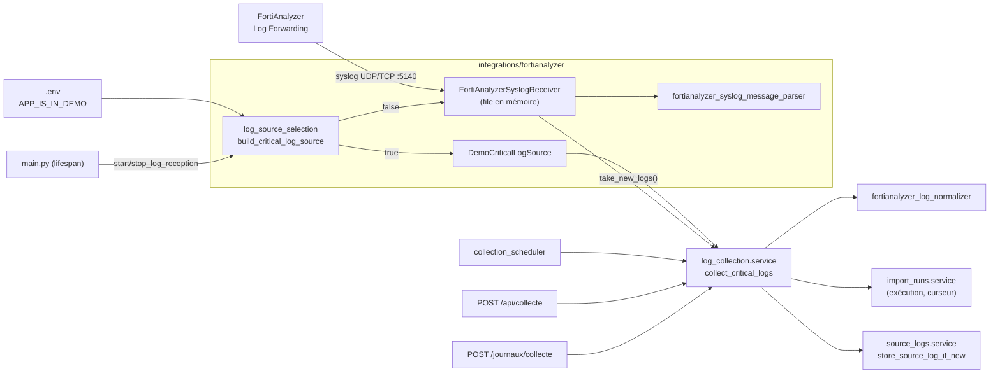

# Collecte des alertes et intégration FortiAnalyzer (syslog)

Code : `backend/features/log_collection/` (règles) et `backend/integrations/fortianalyzer/` (sources).
Guide de mise en service : [docs/overview/connecting_fortianalyzer.md](../overview/connecting_fortianalyzer.md).

FortiAnalyzer **pousse** ses logs par syslog (« Log Forwarding ») : l'application **écoute** un port (UDP et/ou TCP),
elle n'interroge aucune API et n'a besoin d'aucun identifiant. L'ancien client API JSON-RPC a été supprimé.

## Architecture

- **Contrat** `CriticalLogSource` (`critical_log_source.py`) : `source_description` + `take_new_logs(début, fin)` qui
  retourne **et retire** les logs arrivés depuis l'appel précédent, ou lève une `FortiAnalyzerError`. La démonstration
  se sert des bornes pour dater ses logs ; le récepteur syslog les ignore (il vide sa file).
- **Récepteur partagé** : démarré une seule fois au lancement (`backend/main.py` → `log_collection.service.start_log_reception`
  → `log_source_selection.start_shared_syslog_receiver`), arrêté à l'extinction. En démonstration, aucun port n'est ouvert.
  Un démarrage raté (port occupé, droits) ne bloque pas l'application : le motif est mémorisé
  (`read_shared_syslog_receiver_startup_error`) et affiché dans Journaux ; une collecte manuelle échoue avec ce motif.
- **Choix de la source** : uniquement dans `log_source_selection.build_critical_log_source(settings)`.
- **Dépendances** : la feature utilise les services publics de `import_runs` et `source_logs` ; elle n'a pas de table.

## Configuration (`backend/core/settings.py`, modèle : `.env.example`)

| Variable | Défaut | Rôle |
|---|---|---|
| `APP_IS_IN_DEMO` | `true` | `true` : démonstration ; `false` : réception syslog |
| `LOG_COLLECTION_INTERVAL_SECONDS` | `0` (`.env.example` : `30`) | Vidage de la file toutes les N s (0 = manuel) |
| `LOG_COLLECTION_MINIMUM_CRITICALITY` | `haute` | Seuil d'enregistrement (validé au démarrage) |
| `SYSLOG_LISTEN_ADDRESS` | `0.0.0.0` | Interface d'écoute |
| `SYSLOG_LISTEN_PORT` | `5140` | Port (UDP et TCP) ; 514 demande des droits administrateur |
| `SYSLOG_IS_UDP_ENABLED` / `SYSLOG_IS_TCP_ENABLED` | `true` / `true` | Protocoles écoutés (au moins un) |
| `SYSLOG_ALLOWED_SENDER_ADDRESSES` | vide (= tous) | IP autorisées, séparées par des virgules |
| `SYSLOG_MAXIMUM_PENDING_LOGS` | `100000` | Taille maximale de la file en mémoire |
| `FORTIANALYZER_TIMEZONE` | `UTC` | Fuseau de `date`+`time` si le log n'a ni `eventtime`, ni `itime`, ni `tz` |

`LOG_COLLECTION_INITIAL_LOOKBACK_HOURS` et toutes les variables de l'API (`FORTIANALYZER_BASE_URL`, `_API_TOKEN`,
`_USERNAME`, `_PASSWORD`, `_ADOM`, `_VERIFY_TLS`, `_CA_BUNDLE_PATH`, `_LOG_TYPES`, `_DEVICE_IDENTIFIER`,
`_SEARCH_FILTER`, `_REQUEST_TIMEOUT_SECONDS`) n'existent plus ; présentes dans un vieux `.env`, elles sont ignorées.

Docker (`docker-compose.yml`) publie `${SYSLOG_LISTEN_PORT:-5140}` en UDP et TCP **sur toutes les interfaces** (c'est le
seul port non limité à `127.0.0.1` : FortiAnalyzer est une autre machine).

## Réception (`fortianalyzer_syslog_receiver.py`, `fortianalyzer_syslog_message_parser.py`)

Format observé sur le FortiAnalyzer de l'équipe (pas d'en-tête RFC 3164/5424) :
`<189>logver=702101706 timestamp=… devname="…" … eventtime=1793351131937197975 tz="+0100" … level="notice" …`

| Étape | Règle |
|---|---|
| Serveurs | `socketserver` (bibliothèque standard). UDP : un seul fil (traitement court). TCP : un fil par connexion, un message par ligne, lecture bornée à 65 535 caractères ; préfixe « octet-counting » RFC 6587 (`123 <189>…`) retiré. |
| Émetteur | Si `SYSLOG_ALLOWED_SENDER_ADDRESSES` est rempli, tout autre émetteur est ignoré et compté (`rejected_sender_message_count`). |
| Validation | `ReceivedSyslogMessage` (Pydantic) : texte ≤ 65 535 caractères, adresse IP valide, protocole `UDP`/`TCP`. Échec ⇒ « illisible ». |
| Lecture | Priorité `<N>` retirée puis conservée ; paires `clé=valeur` lues avec `(\w+)=("([^"]*)"|\S+)` (valeurs entre guillemets entières). Aucune paire ⇒ « illisible ». |
| Métadonnées | Le log reçoit un champ `reception_syslog` = `{adresse_emetteur, protocole, recu_le, priorite_syslog}` (`SYSLOG_RECEPTION_METADATA_FIELD`). |
| File | `deque` protégée par un verrou. Pleine ⇒ message perdu et compté (`dropped_because_queue_full_count`), un avertissement par tranche de 1 000. |
| Remise | `take_new_logs` vide la file. Écoute inactive **et** file vide ⇒ `SyslogReceptionError` (une panne ne doit pas passer pour une collecte réussie vide). |

Limites assumées :
- **File en mémoire** : les logs reçus mais pas encore collectés sont perdus si l'application s'arrête ; de même les
  logs pris sur la file quand l'enregistrement en base échoue en cours de collecte. FortiAnalyzer conserve ses logs.
- **Syslog non authentifié, non chiffré** : n'importe quelle machine qui atteint le port peut envoyer de faux logs ;
  d'où `SYSLOG_ALLOWED_SENDER_ADDRESSES` (l'adresse vue par le conteneur ; avec le NAT de Docker/WSL, vérifier dans
  `reception_syslog.adresse_emetteur` d'un log reçu) et le pare-feu. Syslog sur TLS non pris en charge.
- **TCP sans retour à la ligne** (octet-counting pur) non pris en charge : les messages doivent finir par `\n`.
- **Un seul processus** : `uvicorn --workers N` ouvrirait N fois le port (échec au 2e). Le `--reload` actuel n'a qu'un
  processus de travail.

Erreurs (`fortianalyzer_errors.py`) : `FortiAnalyzerConfigurationError` (réglages syslog invalides),
`SyslogReceptionError` (port non ouvert, écoute inactive), toutes deux filles de `FortiAnalyzerError`.

## Conversion (`fortianalyzer_log_normalizer.py`) — règles PROVISOIRES

| Donnée | Règle |
|---|---|
| Sévérité | `severity` (IPS) prioritaire, sinon `level`. emergency/alert/critical → critique ; error/high → haute ; warning/medium → moyenne ; notice/low → faible ; information/info/debug → information. Inconnue ⇒ log invalide. |
| Date | `eventtime` (s, ms, µs ou ns : divisé par 1000 tant que > 1e11), sinon `itime` (s), sinon `date`+`time` dans le fuseau du champ `tz` (`+0100`), à défaut `FORTIANALYZER_TIMEZONE`. Le champ `timestamp` est **ignoré** : sur le FortiAnalyzer de l'équipe il est décalé d'une heure (heure locale écrite comme de l'UTC). |
| Type (= catégorie d'incident, choix du playbook) | `subtype`, sinon `type`, sinon `inconnu`. Logs de trafic : `local`, `forward`… |
| `identifiant_source` | `faz-` + SHA-256 du log sérialisé (clés triées) **sans** `reception_syslog` : un même log reçu deux fois est un doublon. |
| `donnees_brutes` | le log complet, métadonnées de réception comprises. |

Vérifié sur une capture réelle de 1 206 messages (non commitée, `tests/fortianalyzer_logs.log` est dans `.gitignore`) :
tous lus et convertis, empreintes toutes distinctes ; sévérités : 1 178 faible (trafic `notice`), 26 haute, 1 moyenne,
1 information.

## Collecte (`service.py`)

1. Période = [curseur de la dernière collecte réussie/partielle, maintenant], ou [maintenant − `FIRST_COLLECTION_PERIOD`
   (5 min), maintenant]. Elle n'est plus une fenêtre de recherche : elle sert à l'historique et à la démonstration.
2. `take_new_logs`. Erreur ⇒ exécution « échouée » (curseur non avancé). Aucun log et
   `is_recorded_when_nothing_received=False` (boucle automatique) ⇒ **rien n'est inscrit**, retour `None`.
   Source indisponible en boucle automatique ⇒ avertissement journalisé, rien d'inscrit (le bandeau de Journaux
   affiche déjà la panne) ; le bouton et `POST /api/collecte` (`True` par défaut) inscrivent toujours l'exécution.
3. Chaque log : conversion (invalide ⇒ compté, motif conservé) ; sous `LOG_COLLECTION_MINIMUM_CRITICALITY` ⇒ écarté ;
   sinon `store_source_log_if_new` (commit par log ; doublon ⇒ « ignoré »).
4. Fin : `reussie` (curseur = fin de période), `partielle` si des logs sont invalides (5 motifs au plus dans
   `erreur`), `echouee` si l'enregistrement échoue.

Compteurs de l'historique : `nb_logs_recus` = logs **retenus** (lus − sous le seuil), car `import_runs` exige pour une
réussite `recus = inseres + ignores`. Le bilan (`LogCollectionResultRead`) détaille aussi `nb_logs_lus_sur_la_source`,
`nb_logs_sous_le_seuil`, `nb_logs_invalides`.

Concurrence : boucle et bouton peuvent collecter en même temps ; la file est vidée atomiquement (chaque log n'est remis
qu'une fois) et la contrainte UNIQUE sur `identifiant_source` empêche tout doublon.

## Routes et interface

- `POST /api/collecte` → bilan ; `GET /api/collecte/configuration` → `LogCollectionConfigurationRead` : mode, adresse
  et port d'écoute, protocoles, émetteurs autorisés, `est_a_l_ecoute`, `erreur_reception`, `reception` (compteurs :
  en attente, acceptés, émetteur refusé, illisibles, perdus file pleine), `parametres_manquants`.
- Page `/journaux` : encadré « Source des alertes » (état de l'écoute et compteurs), bandeau rouge « Réception syslog
  inactive » avec le motif, bouton `POST /journaux/collecte`. Badge « DÉMO » dans la barre du haut en démonstration.
- `scripts/load_synthetic_demo_data.py` refuse de s'exécuter si `APP_IS_IN_DEMO=false`.

## Tests

- `tests/integrations/fortianalyzer/test_fortianalyzer_syslog_receiver.py` : lecture d'un message (priorité, guillemets,
  métadonnées), file, filtre des émetteurs, file pleine, message trop long, écoute inactive, **sockets réels sur
  127.0.0.1 port libre** (UDP ; TCP avec deux messages dont un en octet-counting), port déjà occupé.
- `tests/integrations/fortianalyzer/test_log_source_selection.py` : démonstration sans port, réglages invalides,
  erreur de démarrage reprise, récepteur partagé, source de démonstration.
- `tests/features/log_collection/` : conversion (dont `tz` et empreinte sans métadonnées), collecte (seuil, doublons,
  double réception, invalides, échec, période, passage vide non inscrit, réception inactive), routes, page.

`tests/conftest.py` force `APP_IS_IN_DEMO=true` et désactive les boucles : les tests n'ouvrent jamais le port du `.env`.
