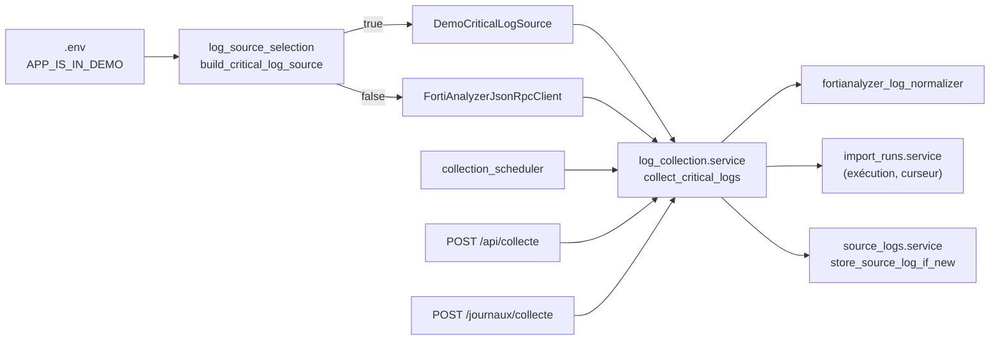

# Collecte des alertes et intégration FortiAnalyzer

Code : `backend/features/log_collection/` (règles) et `backend/integrations/fortianalyzer/` (sources).
Guide de mise en service : [docs/overview/connecting_fortianalyzer.md](../overview/connecting_fortianalyzer.md).

## Architecture

- **Contrat** `CriticalLogSource` (`critical_log_source.py`) : `source_description` + `fetch_logs_between(début, fin)`
  qui renvoie des logs bruts (dictionnaires) ou lève une `FortiAnalyzerError`. La collecte ne connaît que ce contrat.
- **Choix de la source** : uniquement dans `log_source_selection.build_critical_log_source(settings)`.
  Mode réel incomplet ⇒ `FortiAnalyzerConfigurationError` ; la collecte la transforme en exécution « échouée »
  (`UnavailableLogSource`) pour que le problème soit visible dans Journaux.
- **Dépendances** : la feature utilise les services publics de `import_runs` et `source_logs` ; elle n'a pas de table.

## Configuration (`backend/core/settings.py`, modèle : `.env.example`)

`APP_IS_IN_DEMO`, `LOG_COLLECTION_INTERVAL_SECONDS` (0 = pas de boucle), `LOG_COLLECTION_INITIAL_LOOKBACK_HOURS`,
`LOG_COLLECTION_MINIMUM_CRITICALITY` (validée au démarrage), `FORTIANALYZER_BASE_URL`, `FORTIANALYZER_API_TOKEN`
(`SecretStr`), `FORTIANALYZER_USERNAME`, `FORTIANALYZER_PASSWORD` (`SecretStr`), `FORTIANALYZER_ADOM`,
`FORTIANALYZER_VERIFY_TLS`, `FORTIANALYZER_CA_BUNDLE_PATH` (prime sur le booléen), `FORTIANALYZER_LOG_TYPES`,
`FORTIANALYZER_DEVICE_IDENTIFIER`, `FORTIANALYZER_SEARCH_FILTER`, `FORTIANALYZER_TIMEZONE`,
`FORTIANALYZER_REQUEST_TIMEOUT_SECONDS`. Le `.env` est transmis au conteneur par `env_file` (`docker-compose.yml`).

## Client JSON-RPC (`fortianalyzer_json_rpc_client.py`)

| Étape | Requête (`POST /jsonrpc`) |
|---|---|
| Connexion (sans jeton) | `exec /sys/login/user` `{user, passwd}` → `session` |
| Jeton (FAZ ≥ 7.2.2) | en-tête `Authorization: Bearer <jeton>`, pas de session |
| Recherche (par type de log) | `add /logview/adom/<adom>/logsearch`, `apiver: 3`, `logtype`, `device: [{devid}]`, `time-range {start, end}` (format `YYYY-MM-DD HH:MM:SS`, fuseau `FORTIANALYZER_TIMEZONE`), `time-order: asc`, `filter` facultatif → `tid` |
| Attente | `get .../logsearch/<tid>` tant que `percentage < 100` (1 s, 120 s max) |
| Pages | `get .../logsearch/<tid>` `offset`/`limit` (500) jusqu'à `total-count` ; arrêt au-delà de 50 000 logs par type |
| Libération | `delete .../logsearch/<tid>` (au mieux) |
| Déconnexion | `exec /sys/logout` (au mieux, même en cas d'erreur) |

Validation Pydantic des réponses (`fortianalyzer_api_schemas.py`) : enveloppe classique (`result: [{status, data}]`)
et logview (`result: {...}`), erreurs dans `error` ou `status.code ≠ 0`.

Erreurs : `FortiAnalyzerConnectionError` (réseau, TLS, délai, HTTP ≠ 200, JSON illisible),
`FortiAnalyzerApiError` (code d'erreur FortiAnalyzer), `FortiAnalyzerConfigurationError` (fuseau inconnu, .env
incomplet). **Les messages ne recopient jamais l'exception d'origine** (elle peut contenir l'URL complète) : seulement
l'opération, le nom de la classe d'erreur et le code. Ils sont en plus nettoyés par `import_runs` avant stockage.

**Non vérifié sur un vrai FortiAnalyzer** : écrit d'après la documentation publique (LogView, apiver 3), testé contre
un faux serveur (`tests/integrations/fortianalyzer/fake_fortianalyzer_server.py`). Points à confirmer à la première
connexion : format exact des réponses de la version installée, syntaxe du `filter`, fuseau attendu pour `time-range`,
noms des champs de sévérité et de date.

## Conversion (`fortianalyzer_log_normalizer.py`) — règles PROVISOIRES

| Donnée | Règle |
|---|---|
| Sévérité | `severity` (IPS) prioritaire, sinon `level`. emergency/alert/critical → critique ; error/high → haute ; warning/medium → moyenne ; notice/low → faible ; information/info/debug → information. Inconnue ⇒ log invalide. |
| Date | `eventtime` (s, ms, µs ou ns : divisé par 1000 tant que > 1e11), sinon `itime` (s), sinon `date`+`time` dans `FORTIANALYZER_TIMEZONE`. Absente/illisible ⇒ invalide. |
| Type (= catégorie d'incident, choix du playbook) | `subtype`, sinon `type`, sinon `inconnu`. |
| `identifiant_source` | `faz-` + SHA-256 du log complet sérialisé (clés triées). Stable entre deux lectures du même log. |
| `donnees_brutes` | le log complet. |

## Collecte (`service.py`)

1. `start_import_run` ; période = [curseur de la dernière collecte réussie/partielle − 10 min, maintenant], ou
   [maintenant − `LOG_COLLECTION_INITIAL_LOOKBACK_HOURS`, maintenant] s'il n'y a pas de curseur.
2. Chaque log : conversion (invalide ⇒ compté, motif conservé) ; sous `LOG_COLLECTION_MINIMUM_CRITICALITY` ⇒ écarté ;
   sinon `store_source_log_if_new` (commit par log ; doublon ⇒ « ignoré »).
3. Fin : `reussie` (curseur = fin de période), `partielle` si des logs sont invalides (5 motifs au plus dans
   `erreur`, curseur avancé), `echouee` si la source lève (curseur **non** avancé ⇒ la période sera relue).

Compteurs de l'historique : `nb_logs_recus` = logs **retenus** (lus − sous le seuil), car `import_runs` exige pour une
réussite `recus = inseres + ignores`. Le bilan renvoyé (`LogCollectionResultRead`) détaille en plus
`nb_logs_lus_sur_la_source`, `nb_logs_sous_le_seuil`, `nb_logs_invalides`.

Concurrence : deux collectes simultanées (boucle + bouton) peuvent lire la même période ; la contrainte UNIQUE sur
`identifiant_source` empêche tout doublon. Chacune crée sa propre exécution.

## Routes et interface

- `POST /api/collecte` → bilan ; `GET /api/collecte/configuration` → mode, adresse, ADOM, types, mode
  d'authentification, variables manquantes (**aucun secret**).
- Page `/journaux` : encadré « Source des alertes », bandeau des variables manquantes, bouton
  `POST /journaux/collecte`. Badge « DÉMO » dans la barre du haut en mode démonstration.
- `scripts/load_synthetic_demo_data.py` refuse de s'exécuter si `APP_IS_IN_DEMO=false`.

## Tests

`tests/integrations/fortianalyzer/` (client contre faux serveur : session, jeton, pagination, attente, erreurs sans
secret ; choix de la source ; source de démonstration) et `tests/features/log_collection/` (conversion, collecte :
seuil, doublons, invalides, échec, curseur, configuration incomplète, routes, page). `tests/conftest.py` force
`APP_IS_IN_DEMO=true` et désactive les boucles pour que le `.env` du poste n'influence jamais les tests.
